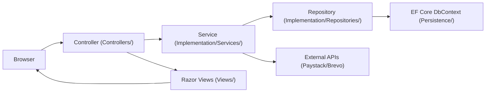

# Architecture

This application is a single ASP.NET Core MVC project that follows a practical layered architecture:

- **Presentation**: MVC controllers + Razor views (`Controllers/`, `Views/`)
- **Application**: services that orchestrate flows (`Interface/Services/`, `Implementation/Services/`)
- **Data access**: repositories + EF Core context (`Interface/Repositories/`, `Implementation/Repositories/`, `Persistence/`)
- **Infrastructure**: identity stores, email sender, template engine, background worker (`Identity/`, `Messaging/`, `Implementation/TemplateEngine/`)

## Request flow (typical)

## Dependency injection and composition

Startup is in `Program.cs`.

Key points:

- Adds MVC (`AddControllersWithViews`), session, cookie auth, and authorization.
- Uses Scrutor to register types ending with `Service` and `Repository` from the project assemblies.
- Registers the EF Core `StudentDbContext` using the `MITCContext` connection string.
- Registers custom Identity stores:
  - `Identity/UserStore.cs` as `IUserStore<User>`
  - `Identity/RoleStore.cs` as `IRoleStore<Role>`
- Registers a hosted background worker:
  - `Implementation/Services/RegistrationDraftCleanupWorker.cs`
- In **Development**, applies migrations automatically (`db.Database.Migrate()`).

## Modules by folder

### `Controllers/`

- `StudentController` — registration steps, dashboard, admin listing/export
- `PaymentController` — payment init + callback
- `WebhookController` — Paystack webhook receiver
- `UserController` — login/logout (cookie auth)
- `DepartmentController` — department CRUD (minimal)
- `HomeController` — default landing pages

### `Models/`

- `Models/Entities/` — DB entities (`Student`, `Department`, `Payment`, `Passport`, `Waec`, `User`, `Role`, `UserRole`, `Admin`, `RegistrationDraft`)
- `Models/DTOs/` — request/response models used between controllers and services
- `Models/DTOs/*/Validation/` — FluentValidation validators for input models
- `Models/Enums/` — `Gender`, `Status`

### `Persistence/`

- `Persistence/Context/StudentDbContext.cs` — entity relationships + seeding

### `Implementation/` + `Interface/`

Services:

- `StudentService` — step orchestration (draft/session), file saving, payment verification -> final creation, admission email
- `PaymentService` — create payment + call Paystack initialize/verify
- `PayStackService` — HTTP calls to Paystack REST API
- `DepartmentService` — department operations
- `UserService` — login + basic profile fetch

Repositories:

- `BaseRepository` — EF helpers (Add/Get/GetAll/Delete/Update)
- `UnitOfWork` — transaction + SaveChanges wrapper
- `StudentRepository`, `DepartmentRepository`, `PaymentRepository`, `UserRepository`, `RolesRepository`, `RegistrationDraftRepository`

### `Identity/`

Custom Identity components (instead of `IdentityDbContext`):

- `UserStore` implements `IUserStore<User>` + password + roles + email interfaces.
- `RoleStore` implements `IRoleStore<Role>`.
- `IdentityService` is a helper that includes hashing, role lookup, and JWT helpers (JWT isn’t used by MVC cookie flow, but can support APIs if added later).

### `Messaging/` + `Implementation/MailingService/` + `Implementation/TemplateEngine/`

- `Messaging/MailSender.cs` — sends transactional email via Brevo API key (`MITCAPIs:BrevoApiKey`), attaches inline assets by scanning HTML for `cid:<filename>`
- `Implementation/MailingService/MailService.cs` — orchestrates template rendering + sending
- `Implementation/TemplateEngine/RazorEngine.cs` — renders Razor views into HTML strings outside of an HTTP request
- `Extensions/EmailAssetRegistry.cs` — maps inline asset filenames (e.g., `mitc_logo.png`) to files under `wwwroot/`

### `Filters/`

- `RegistrationStepFilter` — blocks step navigation when required session state is missing.

### `Migrations/`

EF Core migrations and snapshot for evolving the MySQL schema.

### `Views/` and `wwwroot/`

- `Views/` contains MVC UI plus the email template view (`SendAdmissionStatus.cshtml`).
- `wwwroot/` contains static content and uploaded files (`wwwroot/uploads/...`).

## Background processing: draft cleanup

`RegistrationDraftCleanupWorker` periodically deletes expired `RegistrationDraft` rows (TTL) so the DB remains bounded.

## Error handling

- UI errors flow to the default MVC error view (`Views/Shared/Error.cshtml`) when `UseExceptionHandler` is enabled (non-development).
- Email/template errors are surfaced via:
  - `Exceptions/Messaging/MailSenderException.cs`
  - `Exceptions/TemplateEngine/RazorEngineException.cs`
