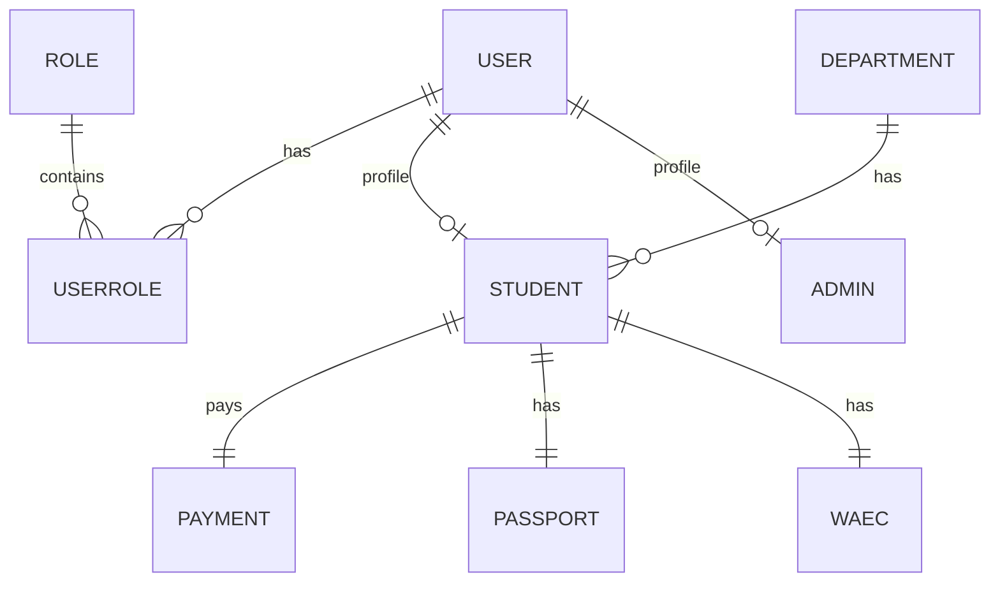

# Database

The app uses Entity Framework Core with MySQL (Pomelo provider).

- DbContext: `Persistence/Context/StudentDbContext.cs`
- Migrations: `Migrations/`

## Entities (schema overview)

Key entities live in `Models/Entities/`:

- `User` — base identity record (email + password hash)
- `Role` — role names (e.g., `Admin`, `Student`)
- `UserRole` — join table between `User` and `Role`
- `Admin` — admin profile linked 1:1 to `User`
- `Student` — student profile linked 1:1 to `User`
- `Department` — department; 1:N with students
- `Passport` — 1:1 with student (photo URL)
- `Waec` — 1:1 with student (exam number/year)
- `Payment` — 1:1 with student (reference/status)
- `RegistrationDraft` — TTL-backed draft data used to complete registration reliably

## Relationships (simplified)



## Seed data

`StudentDbContext.OnModelCreating` seeds:

- A role named `Admin`
- A role named `Student`
- An initial admin user + admin profile + user-role record

If you use the seeded admin in real environments, change the credentials and/or remove seed data after bootstrapping.

## Migrations

In **Development**, `Program.cs` runs `db.Database.Migrate()` on startup.

For production, apply migrations explicitly (recommended):

```powershell
dotnet tool restore  # if your solution uses local tools (optional)
dotnet ef database update
```

If `dotnet ef` isn’t available, install EF tools:

```powershell
dotnet tool install --global dotnet-ef
```
